# VISION — Probability Card Game

**Team 23** · **Project Repository:** [etk005/cse110-team-23](https://github.com/etk005/cse110-team-23)

VISION is a browser card game designed for practicing conditional probability. In the primary deduction mode, a hidden card is drawn from a deck; as the player receives clues about its attributes (color, suit, rank, parity), they calculate and submit the conditional probability of various questions. In the Risk / Reward minigame, players calculate probabilities and expected values to push their luck or cash out chips.

Built with TypeScript, [Konva](https://konvajs.org/) for canvas rendering, Vite for bundling and dev server, Vitest for unit testing, Zod for runtime level validation, and [Supabase](https://supabase.com/) for authentication and user sessions.

---

## 1. Getting Started

### Prerequisites
- **Node.js**: v20 or newer (CI runs on Node 22)
- **npm**
- **Docker** (required by Supabase CLI for running local Supabase containers)

### Setting Up Supabase
The project uses Supabase for user authentication and session management.

1. **Copy the environment configuration:**
   ```bash
   cp .env.example .env
   ```
   The `.env.example` file contains pre-configured local development values and keys connecting to your local Supabase instance.

2. **Start the local Supabase services:**
   ```bash
   npx supabase start
   ```

> [!WARNING]
> **Resource Management:** Unless Supabase is stopped, it will keep running in the background and consuming resources (Docker containers, CPU, memory, and battery) on your computer. When you are done working or playing, make sure to stop it with:
> ```bash
> npx supabase stop
> ```

### Quick Start
```bash
# 1. Install dependencies
npm install

# 2. Configure environment and start local Supabase
cp .env.example .env
npx supabase start

# 3. Run the local dev server with hot reload
npm run dev
```

Vite prints a local URL, typically `http://localhost:5173`. Open it in your browser. If you are not currently signed in, you will be directed to the **Auth Screen** to sign up or sign in. Once authenticated, you will be taken to the **Main Menu**.

### Key Commands

| Command | Purpose |
|---|---|
| `npm run dev` | Start the local dev server with hot reload |
| `npm test -- --run` | Run all unit tests once using Vitest (`npm test` runs in watch mode) |
| `npx tsc --noEmit` | Type-check the entire TypeScript codebase |
| `npm run validate-levels` | Validate all JSON level files against the level schema |
| `npm run build` | Type-check and produce an optimized production bundle in `dist/` |
| `npx supabase start` | Start local Supabase background services (Docker) |
| `npx supabase stop` | Stop local Supabase services to free system resources |

> **CI Pipeline:** GitHub Actions automatically runs type-checking (`tsc`), unit tests (`vitest`), level schema validation, and the production build on every push and pull request.

---

## 2. Current State of the Project (Developer Overview)

The codebase provides a full-featured application loop with local Supabase authentication, procedural question generation, an in-game hint economy, and a dedicated Risk / Reward minigame:

$$\begin{aligned}
\text{App Launch} &\longrightarrow \text{Session Check} \longrightarrow \begin{cases} \text{Auth Screen (Sign In / Sign Up)} \longrightarrow \text{Main Menu} \\ \text{Main Menu (if session active)} \end{cases} \\
\text{Main Menu} &\longrightarrow \begin{cases} \text{Level Select} \longrightarrow \text{Game Screen} \longrightarrow \text{Results Screen} \longrightarrow \text{Play Again / Main Menu} \\ \text{Risk / Reward Minigame} \longrightarrow \text{Main Menu} \\ \text{Sign Out} \longrightarrow \text{Auth Screen} \end{cases}
\end{aligned}$$

### What Is Working Now

- **User Authentication & Session Management:**
  - Integrated Supabase client (`src/lib/supabase.ts`) supporting email/password sign-in and sign-up.
  - Dedicated **Auth Screen** featuring interactive Sign In and Sign Up tabs with custom text input fields.
  - Automatic session detection on application load via an asynchronous loading screen; active sessions bypass login directly to the Main Menu.
  - Sign-out button on the Main Menu to end the active session.
- **Dynamic Question Generation:**
  - Replaced hardcoded questions with a dynamic procedural question generator (`src/game/questionGenerator.ts`).
  - Synthesizes probability questions across card attributes: suit, color, parity, category (ace, number, face), and rank comparisons (`greater_than`, `less_than`).
  - Automatically filters for unasked questions and prioritizes mathematically interesting conditions ($0 < P < 1$) based on currently plausible cards.
- **Complete Deduction Gameplay Loop:**
  - Selecting a level picks a random hidden card from the level deck, reveals an initial clue, generates a dynamic question, and tracks possible remaining cards.
  - Answer evaluation (`src/game/numberInput.ts`) supports fractions (e.g., `1/4`) and decimals (e.g., `0.25`), validating against the true conditional probability of the remaining card pool.
  - Correct answers award progress and reveal subsequent non-redundant clues; incorrect answers incur strikes until the level limit.
- **Deck Inspection & Hint Economy (Spending Chips):**
  - **View Deck / Possible Cards:** In-game modal displaying visual card tiles of the complete level deck or the subset of plausible remaining cards.
  - **Hint System (Buy Info):** Players can spend earned chips for hints:
    - *Probability Range:* Narrows down the target answer to a bounded decimal range (e.g., between `0.20` and `0.40`).
    - *Remaining Cards:* Unlocks the ability to inspect all cards currently consistent with revealed clues.
- **Player Resources & Global Economy:**
  - A unified `PlayerResources` service manages chip/coin balances and scoring across the main game and minigame.
  - Completing levels awards score points scaled by strike count penalties, tracking best scores per level and total aggregate score.
- **Risk / Reward Minigame:**
  - Standalone push-your-luck game accessible directly from the Main Menu.
  - Features a 21-card deck (14 Reward cards, 7 Risk cards) displayed in a $7 \times 3$ grid.
  - Turn cycle:
    1. *Calculating:* Players calculate and submit $P(\text{Risk})$, $P(\text{Reward})$, and expected value with live input validation and feedback.
    2. *Flipping:* Upon calculating correctly, the player flips a face-down card.
    3. *Decision:* Flipping a Reward card grants temporary chips and prompts the player to either **Cash Out** (banking winnings to the global chip balance) or **Continue**.
    4. *Bust:* Flipping a Risk card loses all unbanked chips for the round.
- **Dynamic Level Loading & Validation:** Available levels are listed in a manifest file and stored as individual JSON files in `public/levels/`. Files are validated at runtime against Zod schemas, with graceful fallback to the main menu on load failures.
- **Adaptive Canvas UI & Reusable Components:** Virtual 1920×1080 Konva stage scaling proportionally to any browser viewport, paired with a reusable `EditableText` component for canvas-aligned HTML inputs.

### Known Limitations / Next Steps

- **Placeholder Level Decks:** Levels 2–5 currently share Level 1's 8-card deck (A–4 of Hearts and Spades) while difficulty progression and expanded card sets are being finalized.
- **Persistent Cloud Database Sync:** While authentication sessions persist via Supabase Auth, player resources (chips, scores) are currently tracked in-memory during the browser session. Syncing player progress and leaderboards to Supabase database tables is planned for upcoming milestones.
- **Variable Reward Multipliers in Risk/Reward:** Risk/Reward minigame cards currently share uniform reward values (1 chip per reward); expanding to weighted reward tiers will introduce more nuanced expected value calculations.

---

## 3. Architecture & Class Structure

The project follows a **Model-View-Controller (MVC) pattern per screen**, governed by a central application shell and shared domain services.

```mermaid
flowchart TD
    subgraph Browser["Browser & Canvas"]
        Window["Browser Window"]
        EditableTextInput["HTML Input Overlays / EditableText"]
        KonvaStage["Konva.Stage (1920x1080 Virtual Canvas)"]
    end

    subgraph AppCore["Core Orchestration"]
        App["App (main.ts)<br/>implements ScreenSwitcher"]
        SupabaseClient["Supabase Client (lib/supabase.ts)"]
    end

    subgraph Screens["Screen Layer (MVC)"]
        Auth["AuthScreen (Controller + View + Forms)"]
        Menu["MenuScreen (Controller + View)"]
        Levels["LevelsScreen (Controller + Model + View)"]
        Loading["LoadingScreen (Controller + View)"]
        Game["GameScreen (Controller + Model + View)"]
        Results["ResultsScreen (Controller + Model + View)"]
        RiskReward["RiskRewardScreen (Controller + Model + View)"]
    end

    subgraph Logic["Framework-Independent Game Logic & Services"]
        Engine["informationEngine.ts<br/>(Generates useful clues)"]
        Filter["cardFilter.ts<br/>(Filters remaining cards)"]
        Matching["informationMatching.ts<br/>(Clue rules & operators)"]
        QGen["questionGenerator.ts<br/>(Procedural question synthesis)"]
        NumInput["numberInput.ts<br/>(Fraction/decimal parsing)"]
        Resources["PlayerResources (playerResources.ts)<br/>(Shared score & chip economy)"]
    end

    subgraph Data["State & Schemas"]
        GameState["GameState (Deck, Clues, Strikes, Hints)"]
        RiskState["RiskRewardDeck & Phase State"]
        Schemas["Zod Schemas (Level, Card, Manifest)"]
    end

    Window -->|Resize| App
    App -->|Owns & Scales| KonvaStage
    App -->|Mediates Navigation| Screens
    App -->|Manages Session| SupabaseClient
    App -->|Instantiates & Shares| Resources

    Auth --> SupabaseClient
    Menu --> SupabaseClient
    Game --> Engine & Filter & QGen & NumInput
    Game --> Resources
    Game --> GameState
    RiskReward --> NumInput
    RiskReward --> Resources
    RiskReward --> RiskState
    Results --> Resources
    Engine --> Matching
    Filter --> Matching
    QGen --> Matching
    Levels --> Schemas
    Screens -.->|Renders text inputs| EditableTextInput
```



### Architectural Roles & Design Principles

1. **Top-Level Orchestrator (`App` & `ScreenSwitcher`):**
   - Located in `src/main.ts`. Owns the Konva Stage, main layer, and window resizing / aspect-ratio preservation.
   - Instantiates shared services, including `PlayerResources`, providing a single source of truth for coins and score across screens.
   - Bootstraps with an asynchronous session check via `supabase.auth.getUser()`, routing to `AuthScreen` or `MenuScreen`.
   - Implements `ScreenSwitcher`. **Controllers are decoupled and never reference one another**; navigation happens strictly by passing screen descriptors (and payloads such as the selected `Level` or outcome `points`) to `switchToScreen()`.

2. **Per-Screen Model-View-Controller (MVC):**
   - **Model:** Manages screen data, rules, and calculations (e.g., `GameScreenModel`, `RiskRewardScreenModel`, `ResultsScreenModel`, `LevelsScreenModel`). **Completely decoupled from Konva and DOM APIs**, allowing comprehensive unit testing without canvas or browser mocks.
   - **View:** Implements the `View` interface (`show()`, `hide()`, `getGroup()`). Responsible purely for rendering Konva nodes, managing overlays (e.g., modal card drawers or HTML inputs), and passing user inputs to controller callbacks.
   - **Controller:** Extends or implements `ScreenController`. Binds view interactions to model and service methods, triggers view updates, and requests screen transitions.

3. **Pure, Framework-Independent Game Logic:**
   - **`questionGenerator.ts`:** Dynamically analyzes deck compositions and candidate conditions to generate rich, contextual conditional probability questions.
   - **`numberInput.ts`:** Parses user input into numeric values, accepting fractions (`1/4`, `3/8`) or decimals (`0.25`), with configurable comparison tolerances.
   - **`playerResources.ts`:** Manages currency (chips/coins) and level scoring, offering pub/sub event subscription (`onChange`) for real-time HUD updates.
   - **`informationMatching.ts`:** The single source of truth for card attributes (rank values, color, parity, category) and operator comparisons (`equals`, `less_than`, `greater_than`).
   - **`informationEngine.ts`:** Houses clue generators filtered via `isUsefulFact()` to guarantee players only receive informative clues.
   - **`cardFilter.ts`:** Pure filter computing the subset of cards consistent with accumulated clues.

4. **Authentication & Backend Integration:**
   - Supabase client initialized via `src/lib/supabase.ts` reading environment configuration (`VITE_SUPABASE_URL`, `VITE_SUPABASE_PUBLISHABLE_KEY`).
   - Local authentication runs entirely offline against local Supabase Docker containers.

5. **Schema-Driven Validation:**
   - Levels, card definitions, and manifests are defined using Zod schemas (`src/shared/schemas.ts`).
   - TypeScript types are inferred directly from schemas.
   - Schemas validate level files both at runtime and during CI checks (`scripts/validate-levels.ts`).

---

## 4. Codebase Layout

```
public/
  Brand.png, card.png       Image assets
  levels/                   manifest.json + level data (1.json … 5.json)
scripts/
  validate-levels.ts        CI validation script for level files
supabase/
  config.toml               Supabase local development configuration
src/
  main.ts                   App entry point: stage scaling, auth bootstrap, and screen routing
  types.ts                  Screen union, ScreenSwitcher, and View interfaces
  constants.ts              Stage bounds (1920x1080), theme palette, and layout dimensions
  cardFilter.ts             Calculates cards consistent with known clues
  components/
    EditableText.ts         Reusable Konva text node with synced HTML input overlay
  game/
    informationEngine.ts    Generates progressive, non-redundant clues
    informationMatching.ts  Evaluates card attributes against clue conditions
    numberInput.ts          Parses and validates fraction/decimal numeric answers
    playerResources.ts      Shared score and coin/chip economy management
    questionGenerator.ts    Procedural question synthesis based on deck & remaining cards
  lib/
    supabase.ts             Supabase client initialization
  shared/
    schemas.ts              Runtime Zod validation schemas
    types.ts                Data types: GameState, Card, KnownInformation, Level, HintKind
  screens/                  Screen implementations (Controller, Model, View)
    AuthScreen/             User authentication (Sign In & Sign Up)
    MenuScreen/             Title display, navigation to game / minigame, sign out
    LevelsScreen/           Level selection grid and JSON fetching/caching
    LoadingScreen/          Async task wrapper with error fallback
    GameScreen/             Core deduction gameplay, question checking, strikes, hints
    ResultsScreen/          Outcome display, level points, total score, and replay routing
    RiskRewardScreen/       Push-your-luck probability minigame (calculating, flipping, cashing out)
  ui/
    widgets.ts              Reusable drawing primitives (rounded panels)
  tests/                    Vitest unit test suites (models, controllers, rules, math)
.env.example                Template environment configuration for local Supabase
```
