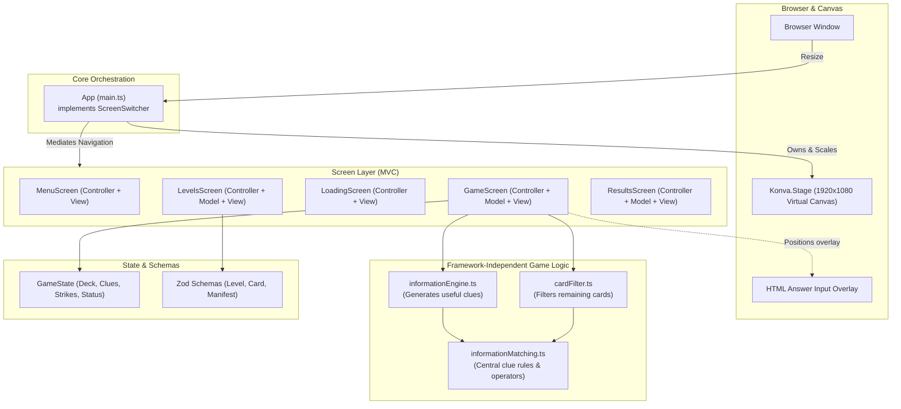

# VISION — Probability Card Game

**Team 23** · **Project Repository:** [etk005/cse110-team-23](https://github.com/etk005/cse110-team-23)

VISION is a browser card game designed for practicing conditional probability. A hidden card is drawn from a deck; as the player receives clues about its attributes (color, suit, rank, parity), they calculate and submit the conditional probability of various questions.

Built with TypeScript, [Konva](https://konvajs.org/) for canvas rendering, Vite for bundling and dev server, Vitest for unit testing, and Zod for runtime level validation.

---

## 1. Getting Started

### Prerequisites
- **Node.js**: v20 or newer (CI runs on Node 22)
- **npm**

### Quick Start
```bash
# 1. Install dependencies
npm install

# 2. Run the local dev server with hot reload
npm run dev
```

Vite prints a local URL, typically `http://localhost:5173`. Open it in your browser and click **Start Game**.

### Key Commands

| Command | Purpose |
|---|---|
| `npm run dev` | Start the local dev server with hot reload |
| `npm test -- --run` | Run all unit tests once using Vitest (`npm test` runs in watch mode) |
| `npx tsc --noEmit` | Type-check the entire TypeScript codebase |
| `npm run validate-levels` | Validate all JSON level files against the level schema |
| `npm run build` | Type-check and produce an optimized production bundle in `dist/` |

> **CI Pipeline:** GitHub Actions automatically runs type-checking (`tsc`), unit tests (`vitest`), level schema validation, and the production build on every push and pull request.

---

## 2. Current State of the Project (Developer Overview)

The codebase provides a **fully playable, end-to-end game loop running in memory** without backend dependencies:

$$\text{Main Menu} \longrightarrow \text{Level Select} \longrightarrow \text{Game Screen} \longrightarrow \text{Results Screen} \longrightarrow \text{Play Again / Main Menu}$$

### What Is Working Now

- **Complete Gameplay Loop:**
  - Selecting a level picks a random hidden card from the level's deck, displays the first question, reveals an initial clue, and calculates the pool of remaining possible cards.
  - Submitting a correct answer reveals the next clue (which progressively narrows down possibilities), recalculates the remaining card pool, and advances to the next question.
- **Dynamic Level Loading & Validation:** Available levels are listed in a manifest file and stored as individual JSON files in `public/levels/`. Files are fetched during an asynchronous loading screen and validated at runtime against Zod schemas. If loading fails, the game gracefully catches the error and returns the player to the main menu.
- **Deduction & Information Engine:**
  - A dedicated information engine evaluates candidate clues (color, suit, parity, category, rank comparisons, exact rank) and cross-references them with the remaining cards.
  - It only reveals a fact if it eliminates at least one plausible card, guaranteeing players never receive useless or redundant clues.
  - A card filter updates the subset of cards that satisfy all accumulated clues after each turn.
- **Answer Evaluation, Strikes, & Progress:** Players input answers as fractions (e.g., `1/4`) or decimals (e.g., `0.25`). The model checks the input against the true conditional probability derived from the remaining cards. Correct answers increment progress; incorrect answers add a strike. Reaching the strike limit ends the game in defeat; answering the required questions ends in victory.
- **Adaptive Canvas UI:** The interface is built on a virtual 1920×1080 stage using Konva that scales proportionally to any browser window. A native HTML text `<input>` overlay is dynamically positioned over the canvas to handle player answers.

### Known Limitations / Next Steps (Sprint 2 Scope)

- **Placeholder Levels:** Levels 2–5 currently share Level 1's 8-card deck (A–4 of Hearts and Spades), 3-strike limit, and 3-question requirement while difficulty curves are finalized.
- **Fixed Questions:** The current question sequence is fixed in the game model rather than generated procedurally or loaded from level configurations.
- **Deck Inspection Panel:** The game tracks remaining plausible cards internally, but a visual on-screen tray showing the deck and filtered cards is scheduled for Sprint 2.
- **Results Screen Target:** Win/loss evaluation on the results screen currently checks against a hardcoded target of 3 questions rather than reading the active level's `questionsRequired`.

---

## 3. Architecture & Class Structure

The project follows a **Model-View-Controller (MVC) pattern per screen**, governed by a central application shell.



### Architectural Roles & Design Principles

1. **Top-Level Orchestrator (`App` & `ScreenSwitcher`):**
   - Located in `src/main.ts`. Owns the Konva Stage, main layer, and window resizing / aspect-ratio preservation.
   - Instantiates all screen controllers and attaches each view's Konva group to the layer.
   - Implements `ScreenSwitcher`. **Controllers are decoupled and never reference one another**; navigation happens strictly by passing screen descriptors (and payloads such as the selected `Level` or final `score`) to `switchToScreen()`.

2. **Per-Screen Model-View-Controller (MVC):**
   - **Model:** Manages screen data, rules, and calculations. **Completely decoupled from Konva and DOM APIs**, allowing comprehensive unit testing without canvas or browser mocks.
   - **View:** Implements the `View` interface (`show()`, `hide()`, `getGroup()`). Responsible purely for rendering Konva nodes and passing user inputs to controller callbacks.
   - **Controller:** Extends `ScreenController`. Binds view interactions to model methods, triggers view updates, and requests screen transitions.

3. **Pure, Framework-Independent Game Logic:**
   - **`informationMatching.ts`:** The single source of truth for card attributes (rank values, color, parity, category) and operator comparisons (`equals`, `less_than`, `greater_than`).
   - **`informationEngine.ts`:** Houses fact generators and filters them via `isUsefulFact()`. Only emits clues that rule out at least one plausible card.
   - **`cardFilter.ts`:** Recomputes the cards in the deck that satisfy all accumulated clues.
   - **Serializable State:** Clues are stored as structured data objects (`property`, `operator`, `value`) rather than closures or functions, ensuring full compatibility with `structuredClone()` and JSON serialization.

4. **Schema-Driven Validation:**
   - Levels, card definitions, and manifests are defined using Zod schemas (`src/shared/schemas.ts`).
   - TypeScript types are inferred directly from schemas.
   - The same schemas validate level files both at runtime and during CI checks (`scripts/validate-levels.ts`).

---

## 4. Codebase Layout

```
public/
  Brand.png, card.png     Image assets
  levels/                 manifest.json + level data (1.json … 5.json)
scripts/
  validate-levels.ts      CI validation script for level files
src/
  main.ts                 App entry point: stage scaling and screen routing
  types.ts                Screen union, ScreenSwitcher, and View interfaces
  constants.ts            Stage bounds (1920x1080), theme palette, and layout ratios
  cardFilter.ts           Calculates cards consistent with known clues
  game/
    informationEngine.ts  Generates progressive, non-redundant clues
    informationMatching.ts Evaluates card attributes against clue conditions
  shared/
    schemas.ts            Runtime Zod validation schemas
    types.ts              Data types: GameState, Card, KnownInformation, Level
  screens/                Screen implementations (Controller, Model, View)
    MenuScreen/           Title display and level select trigger
    LevelsScreen/         Level selection grid and JSON fetching/caching
    LoadingScreen/        Async task wrapper with error fallback
    GameScreen/           Core gameplay, question checking, and strike tracking
    ResultsScreen/        Outcome display, score, and replay routing
  ui/
    widgets.ts            Reusable drawing primitives (rounded panels)
  tests/                  Vitest unit test suites (models, controllers, rules)
```
